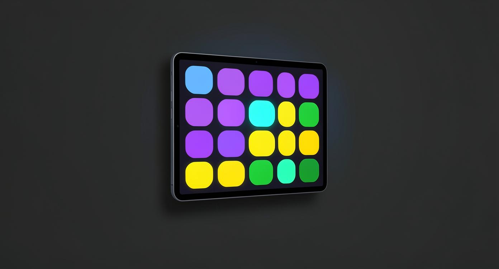

<div align="center">



# Macro Deck Kiosk

**Transforme une tablette Android en deck de touches plein écran pour [Macro Deck 3](https://macro-deck.app).**
Pas de navigateur, pas de barre système, pas d'application payante.

[](https://github.com/Tom1419-git/macrodeck-kiosk-apk/releases)
[](https://github.com/Tom1419-git/macrodeck-kiosk-apk/releases)
[](#-compatibilité)
[](https://github.com/Tom1419-git/macrodeck-kiosk-apk/releases/download/v1.4/MacroDeckKiosk.apk)
[](LICENSE)

**[⬇ Télécharger l'APK (v1.4)](https://github.com/Tom1419-git/macrodeck-kiosk-apk/releases/download/v1.5/MacroDeckKiosk.apk)** ·
[Releases](https://github.com/Tom1419-git/macrodeck-kiosk-apk/releases) ·
[Installation](#-installation) ·
[Écran lié au PC](#-écran-lié-au-pc-option) ·
[Guide d'installation](#-guide-dinstallation) ·
[Dépannage](#-dépannage)

</div>

---

## 💡 L'idée

Le web client de Macro Deck 3 fait très bien le travail, mais dans un navigateur il garde
sa barre d'adresse, ses gestes de navigation et sa mise en veille. Pour une tablette
posée au mur ou sur le bureau, ça casse tout.

**Macro Deck Kiosk** est une coquille Android de 46 Ko, sans dépendance, qui affiche ce
même web client en plein écran immersif et le garde vivant : écran allumé, reconnexion
automatique si le PC s'éteint, relance au démarrage de la tablette, et — en option —
allumage et extinction de l'écran avec le PC. Le deck reste celui
de Macro Deck — mêmes widgets, mêmes icônes, mêmes dossiers — mais on ne voit que lui.

## ✨ Fonctionnalités

|     | Fonction | Détail |
| :-: | --- | --- |
| 🖥️ | **Plein écran immersif** | Barres Android masquées ; elles ne reviennent qu'en glissant depuis le bord, et disparaissent aussitôt. |
| 🔆 | **Écran toujours allumé** | `FLAG_KEEP_SCREEN_ON` : la tablette ne s'endort pas pendant que le deck est affiché. |
| 🔄 | **Reconnexion automatique** | PC éteint ou en redémarrage ? Un écran « PC injoignable » s'affiche et retente toutes les 5 s ; le deck revient seul. |
| ⚡ | **Démarrage avec la tablette** | Récepteur `BOOT_COMPLETED`, plus les actions « démarrage rapide » de certains constructeurs et la fin d'une mise à jour. |
| 💾 | **Adresse mémorisée** | Saisie une seule fois, au premier lancement, puis conservée dans les préférences de l'app. |
| 🎛️ | **Reconfiguration sans câble** | `Volume +` et `Volume −` en même temps ramènent à l'écran d'adresse. |
| 🔌 | **Écran lié au PC** (option) | La tablette s'allume quand le PC démarre et s'éteint quand il s'arrête — voir [Écran lié au PC](#-écran-lié-au-pc-option). |
| 🔔 | **Service discret** | Sonde réseau en service au premier plan, notification réduite au minimum, relance automatique si le système l'arrête. |
| ↩️ | **Sortie volontaire** | Deux appuis sur Retour pour quitter, avec un toast de confirmation. |
| 🔊 | **Audio autorisé** | Lecture sans geste utilisateur, pour les widgets Music Player. |
| 📶 | **Réseau local** | HTTP en clair vers le PC, via une configuration réseau dédiée à l'app. |

## ✅ Compatibilité

- **Android 7.0+** (`minSdk 24`), `targetSdk 34`, en paysage.
- Développé et testé sur une **Xiaomi Pad 6** (HyperOS, Android 14).
- Fonctionne avec **Macro Deck 3** ; le web client écoute sur le port **8193**.

## 📦 Installation

1. Télécharger **[MacroDeckKiosk.apk](https://github.com/Tom1419-git/macrodeck-kiosk-apk/releases/download/v1.4/MacroDeckKiosk.apk)**.
2. Sur la tablette, ouvrir le fichier depuis **Fichiers → Téléchargements** et autoriser
   « Installer des applis inconnues » pour l'app Fichiers si demandé.
3. Lancer **Macro Deck**, saisir l'adresse du PC (par exemple `192.168.1.50:8193`), puis
   **Se connecter**.

Sur la tablette, tout ce que fait le web client (musique, lumières, volume, navigation)
fonctionne à l'identique : l'APK n'est qu'une coquille autour du même deck.

## 🔌 Écran lié au PC (option)

Activée par défaut, débrayable dans l'app : sur l'écran d'adresse, le bouton
**« Écran lié au PC : activé / désactivé »**. Elle répond à une envie simple — allumer le
PC allume la tablette, éteindre le PC éteint la tablette — sans rien installer sur le PC.

**Comment ça marche.** Un service au premier plan sonde `http://<pc>:8193/` toutes les 4 s
avec un verrou CPU partiel, donc aussi écran éteint. Dès que le PC ne répond plus pendant
~20 s (arrêt, veille, hibernation), l'écran s'éteint ; dès qu'il répond de nouveau
(démarrage de Windows + Macro Deck), l'écran se rallume et le deck se recharge.

**Trois autorisations, une seule fois**, depuis l'écran d'adresse :

| Bouton | Sans lui |
| --- | --- |
| **Autoriser l'allumage auto** (afficher par-dessus les autres applis) | L'option reste sans effet : Android 10+ interdit de rallumer l'écran depuis l'arrière-plan. L'app ne dort donc jamais si elle ne peut pas se réveiller. |
| **Activer l'extinction auto** (administrateur, politique `force-lock` uniquement) | L'écran s'éteint au bout du délai de veille système au lieu de s'éteindre immédiatement. |
| **Batterie : aucune restriction** | HyperOS peut tuer le service pendant la nuit : le PC redémarrerait sans rallumer la tablette. |

En ligne de commande (voir [`docs/PROMPT-INSTALLATION.md`](docs/PROMPT-INSTALLATION.md)) :

```bash
adb shell appops set com.macrodeck.kiosk SYSTEM_ALERT_WINDOW allow
adb shell dpm set-active-admin com.macrodeck.kiosk/.KioskAdmin
adb shell dumpsys deviceidle whitelist +com.macrodeck.kiosk
adb shell am start -n com.macrodeck.kiosk/.MainActivity --ez power_link false
```

Aucune donnée n'est effaçable par cette app : l'administrateur sert uniquement à
verrouiller l'écran (`lockNow`).

> [!WARNING]
> Une **mise à jour de l'APK** peut réinitialiser l'autorisation « Afficher par-dessus
> les autres applis » (constaté sous HyperOS). Dans ce cas l'option se met en veille pour
> ne pas éteindre un écran qu'elle ne saurait pas rallumer, et l'app le signale au
> lancement. Les trois boutons de l'écran d'adresse affichent l'état réel (« Allumage
> auto : autorisé » quand tout est bon). En ligne de commande :
> `adb shell appops set com.macrodeck.kiosk SYSTEM_ALERT_WINDOW allow`.

## 🤖 Guide d'installation

[`docs/PROMPT-INSTALLATION.md`](docs/PROMPT-INSTALLATION.md) contient un **prompt prêt à
coller** dans un agent de codage (Freebuff, Claude Code, Codex, Cursor…) : il active le
débogage adb (USB ou sans fil), installe l'APK, accorde les autorisations, vérifie le
premier affichage et teste le lien écran/PC. La même page décrit l'installation manuelle.

## 🔑 Première connexion (une seule fois)

Le web client de Macro Deck 3 exige une session : au premier lancement, la tablette
affiche **« Sign in to continue »**. Sur le PC, ouvrir le panneau **Réseau** (icône Wi-Fi
en haut à droite) de Macro Deck et saisir le **code d'appairage** à 6 chiffres sur la
tablette.

La session est stockée dans les données de l'app : elle survit aux mises à jour, mais pas
à une désinstallation.

## 🚀 Démarrage automatique

L'app se relance seule au démarrage de la tablette.

> [!IMPORTANT]
> Sur **Xiaomi / Redmi / POCO (MIUI, HyperOS)**, l'autorisation est obligatoire, sinon le
> système bloque le broadcast de démarrage :
> **Paramètres → Applications → Gérer les applications → Macro Deck → Démarrage auto**,
> puis **Batterie → Aucune restriction**.

Sur les autres marques, rien à faire au-delà de l'installation. Android 10+ peut aussi
demander « Autoriser le démarrage en arrière-plan » : accepter.

## 🛠️ Dépannage

| Symptôme | Cause / solution |
| --- | --- |
| **Grille grise sans icônes** | Le WebView n'a pas encore chargé le pack d'icônes. L'app purge son cache et se relance d'elle-même ; sinon redémarrer la tablette une fois la connexion établie. |
| **« PC injoignable » en boucle** | Macro Deck n'est pas lancé, le PC et la tablette ne sont pas sur le même Wi-Fi, ou le pare-feu Windows bloque Macro Deck sur le réseau privé. Tester l'adresse depuis le navigateur de la tablette. |
| **Pas de relance après redémarrage** | Autorisation « Démarrage auto » non accordée (voir ci-dessus). |
| **`INSTALL_FAILED_UPDATE_INCOMPATIBLE`** | L'APK installé vient d'une autre clé de signature : désinstaller l'ancienne version avant d'installer celle-ci. |
| **Mauvaise adresse** | `Volume +` et `Volume −` en même temps, ou **Changer d'adresse** depuis l'écran « PC injoignable ». |

## 🔧 Recompiler

Prérequis : un **JDK 17+** (`JAVA_HOME`) et un **SDK Android** avec les *build-tools 35*
et la plateforme *android-34*.

```bash
ANDROID_SDK=/chemin/vers/android-sdk bash build.sh   # → MacroDeckKiosk.apk
```

Pas de Gradle : `aapt2` + `javac` + `d8` + `zipalign` + `apksigner`. La clé de signature
est créée au premier build dans `keystore/` (dossier ignoré par git) : conserve-la pour
publier des mises à jour installables par-dessus l'ancienne version.

## 🗂️ Structure du dépôt

```text
AndroidManifest.xml              manifeste (minSdk 24, targetSdk 34)
src/com/macrodeck/kiosk/
├── MainActivity.java            WebView plein écran, reconnexion, watchdog
├── DeckPowerService.java        sonde le PC, allume/éteint l'écran
├── KioskAdmin.java              administrateur (verrouillage d'écran uniquement)
└── BootReceiver.java            relance au démarrage de la tablette
docs/PROMPT-INSTALLATION.md      installation assistée par un agent IA
res/                             icônes, thème, configuration réseau, politique admin
tools/make_icons.py              génère les icônes (Pillow)
build.sh                         compilation + signature, sans Gradle
MacroDeckKiosk.apk               APK signé, prêt à installer
```

## 📝 Notes

- Aucune configuration personnelle n'est incluse dans ce dépôt : ni adresse de PC, ni
  profil de deck, ni identifiant. L'adresse se saisit sur la tablette au premier
  lancement.
- Le projet n'est pas affilié à Macro Deck : il s'agit d'un simple afficheur plein écran
  pour son web client.

## 🕒 Versions

- **1.5** — identifiant d'application neutre (`com.macrodeck.kiosk`) : plus rien de personnel
  dans le paquet. Changer d'identifiant installe une **nouvelle app** : désinstaller la
  1.4 avant d'installer celle-ci.
- **1.4** — option « écran lié au PC » (la tablette s'allume et s'éteint avec le PC),
  boutons d'autorisation dans l'app, guide d'installation pour un agent IA.
- **1.3** — première version publique : kiosque plein écran, reconnexion automatique,
  démarrage avec la tablette, purge du cache.

## 📄 Licence

[MIT](LICENSE) — fais-en ce que tu veux, y compris pour ton propre deck.

---

## Crédits

Ce projet a été conçu et écrit en **pair-programmation avec une IA** : [Buffy](https://freebuff.com),
l'agent de codage de Freebuff, a participé au code Java, aux ressources, aux icônes, au
script de compilation et à cette documentation, sous la direction de **Tom1419-git**, qui
maintient le dépôt et en valide chaque version.
